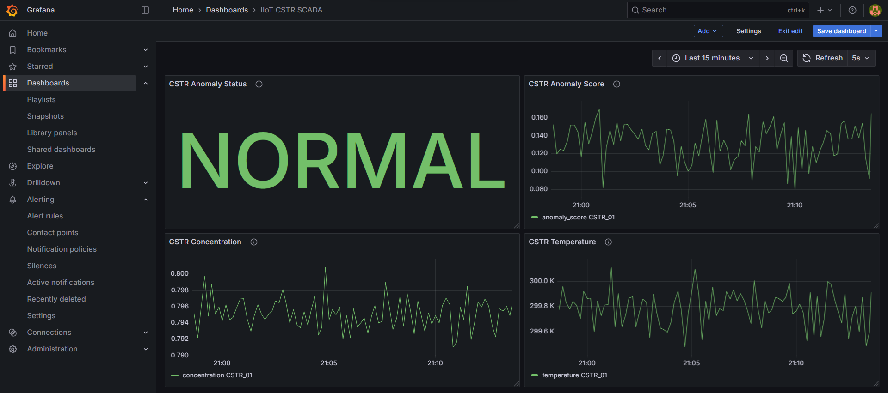
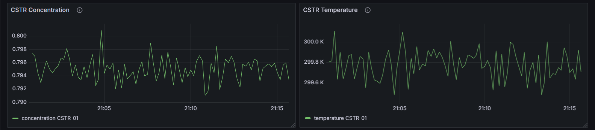
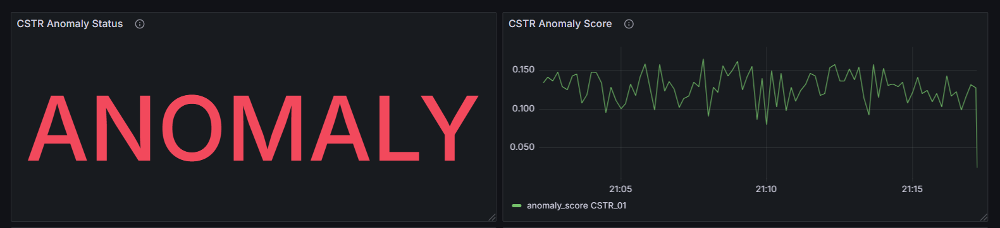
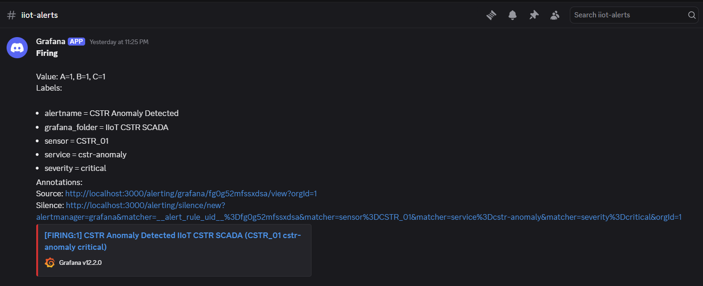
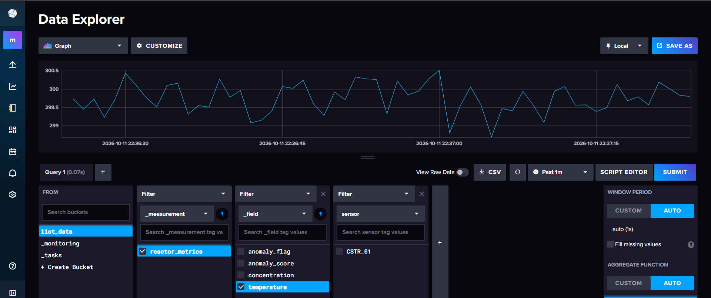
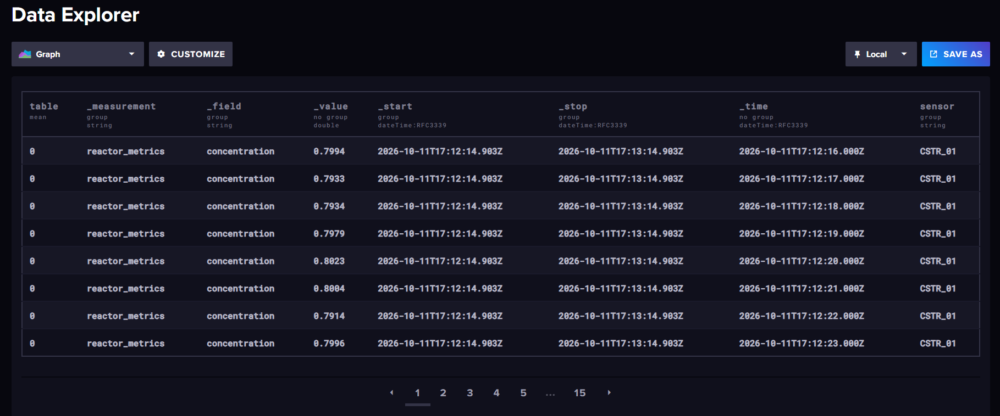
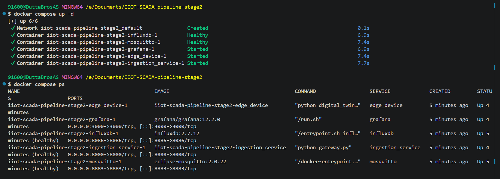

# IIoT–SCADA Pipeline: CSTR Digital Twin, MQTT, and Anomaly Detection

[](https://github.com/sauravdutta-ai/IIoT-SCADA-Pipeline/actions/workflows/ci.yml)


A locally deployable Industrial Internet of Things (IIoT) and SCADA-style monitoring pipeline. A simulated continuous stirred-tank reactor (CSTR) produces telemetry, an authenticated TLS-protected MQTT broker transports it, a FastAPI gateway validates and analyzes it, InfluxDB stores time-series measurements, and Grafana visualizes the data and supports alerting.

> **Project scope:** This is an engineering demonstration built around simulated process data. It is not a certified safety system and has not been validated for direct control of a physical industrial process.

## Dashboard Preview

The Grafana dashboard provides a unified view of reactor status, anomaly scores, concentration, and temperature.



## Contents

- [Architecture](#architecture)
- [Technology stack](#technology-stack)
- [Repository layout](#repository-layout)
- [Prerequisites](#prerequisites)
- [Fresh-checkout setup](#fresh-checkout-setup)
- [Start and operate the stack](#start-and-operate-the-stack)
- [Service endpoints](#service-endpoints)
- [Telemetry schema and processing](#telemetry-schema-and-processing)
- [Grafana dashboards and Discord alerts](#grafana-dashboards-and-discord-alerts)
- [Security configuration](#security-configuration)
- [Verification and tests](#verification-and-tests)
- [Troubleshooting](#troubleshooting)
- [Known limitations](#known-limitations)
- [Shutdown and data persistence](#shutdown-and-data-persistence)
- [License](#license)

## Architecture

```mermaid
flowchart LR
    A["CSTR digital twin<br/>Python + SciPy"] -->|"MQTT over TLS 1.2<br/>edge_publisher"| B["Mosquitto broker"]
    B -->|"plant/reactor/telemetry<br/>gateway_subscriber"| C["FastAPI ingestion gateway"]
    C --> D["Pydantic validation"]
    D --> E["Rolling telemetry buffer"]
    E --> F["Isolation Forest"]
    D --> G["InfluxDB 2.x"]
    F --> G
    G --> H["Grafana dashboards"]
    H --> I["Grafana alerting"]
    I --> J["Discord webhook"]
```



### Data flow

1. **Edge digital twin:** solves the CSTR model using `scipy.integrate.solve_ivp`, adds small Gaussian noise to simulated sensor values, and publishes JSON telemetry.
2. **MQTT broker:** Eclipse Mosquitto authenticates clients and uses TLS 1.2. The edge identity is intended to publish telemetry; the gateway identity is intended to subscribe to it.
3. **Ingestion gateway:** validates incoming messages with Pydantic, maintains a bounded rolling buffer, evaluates measurements with an Isolation Forest, and writes measurements to InfluxDB.
4. **Time-series storage:** InfluxDB persists telemetry in the configured bucket.
5. **Monitoring and alerting:** Grafana queries InfluxDB for dashboards and alert rules. A Discord contact point can deliver notifications.

## Technology stack

- **Language and numerical computing:** Python, NumPy, SciPy
- **API and validation:** FastAPI, Pydantic
- **Messaging and transport security:** Eclipse Mosquitto, MQTT, TLS 1.2, OpenSSL, Paho MQTT
- **Anomaly detection:** scikit-learn Isolation Forest
- **Time-series database:** InfluxDB 2.x
- **Visualization and alerting:** Grafana, Flux, Discord webhook
- **Deployment:** Docker, Docker Compose

## Repository layout

The paths below describe the expected layout used by the Compose configuration and setup scripts. If your checkout differs, use the files actually present in your branch.

```text
IIOT-SCADA-pipeline-stage2/
├── certs/                         # Generated certificates; private keys must stay private
├── config/
│   └── mosquitto/
│       ├── acl                    # MQTT topic permissions
│       └── passwd                 # Generated Mosquitto password file
├── edge_device/
│   ├── Dockerfile
│   ├── digital_twin.py
│   └── requirements.txt
├── ingestion_service/
│   ├── Dockerfile
│   ├── gateway.py
│   └── requirements.txt
├── Media/                         # Project screenshots, if included in the checkout
├── .env.example                   # Safe configuration template
├── .gitignore
├── docker-compose.yml
├── mosquitto.conf
├── generate_certs.sh
└── generate_mqtt_credentials.sh
```

The Compose file builds the `edge_device` and `ingestion_service` images and starts all five services. **Do not launch separate local Python copies of the gateway or digital twin while the Compose versions are running**, unless you intentionally want duplicate clients.

## Prerequisites

- Docker Desktop (Windows/macOS) or Docker Engine with the Docker Compose plugin (Linux)
- Git
- OpenSSL for local TLS certificate generation
- Git Bash is useful on Windows for running the repository's `.sh` scripts

The application services run in containers, so a separate host Python virtual environment is not required for the standard deployment.

## Fresh-checkout setup

Run the following from the repository root.

### 1. Create your local environment file

```bash
cp .env.example .env
```

Edit `.env` and replace every `CHANGE_ME` value with a unique local secret. Do not commit `.env`.

At minimum, configure:
- `MQTT_EDGE_PASSWORD`
- `MQTT_GATEWAY_PASSWORD`
- `INFLUX_PASSWORD`
- `INFLUX_TOKEN`
- `GRAFANA_ADMIN_PASSWORD`

Use strong, unique values. The InfluxDB token must be consistent with the token used by the gateway and Grafana data source. Do not paste secrets into issue reports or commit them to source control.

### 2. Generate TLS certificates

The Compose configuration expects these files:

```text
certs/ca.crt
certs/server.crt
certs/server.key
```

Run the repository certificate-generation script:

```bash
bash generate_certs.sh
```

The script should create a local certificate authority and a broker certificate/key. Review its output and verify the expected files exist before starting the stack. Keep `certs/ca.key` and `certs/server.key` private; they are not application configuration files and must never be committed.

If the script is not executable in your environment, invoking it with `bash` avoids needing the executable bit. On Windows Git Bash, `MSYS_NO_PATHCONV=1` may be needed for commands that pass Linux-style paths into Docker.

### 3. Generate MQTT credentials

The Compose configuration mounts `config/mosquitto/passwd` into Mosquitto. Generate the broker's password file with the repository script:

```bash
bash generate_mqtt_credentials.sh
```

Follow the prompts/output from the script and use the same MQTT usernames/passwords as the corresponding `.env` entries. The configured usernames are:

- `edge_publisher`
- `gateway_subscriber`

The active ACL file is `config/mosquitto/acl`. The intended permissions are:

```text
user edge_publisher
topic write plant/reactor/telemetry

user gateway_subscriber
topic read plant/reactor/telemetry
topic read $SYS/broker/version
```

The ACL describes intended least-privilege access; see [Known limitations](#known-limitations) for the outstanding read-permission verification note.

### 4. Check required files and configuration

Before starting, verify that the files mounted by Compose exist:

```text
.env
mosquitto.conf
config/mosquitto/acl
config/mosquitto/passwd
certs/ca.crt
certs/server.crt
certs/server.key
```

Review `docker-compose.yml` and `.env.example` together if you have customized the deployment. Some internal container addresses and ports are set directly in Compose rather than being user-overridable `.env` settings.

### 5. Build and start the services

```bash
docker compose config
docker compose up -d --build
```

The first command validates the Compose configuration and interpolated variables; it may display resolved configuration, so do not share output if it contains sensitive values. The second builds the Python service images and starts the stack.

Check service state:

```bash
docker compose ps
```

Follow logs when troubleshooting:

```bash
docker compose logs -f mosquitto
docker compose logs -f ingestion_service
docker compose logs -f edge_device
```

Use `Ctrl+C` to stop following logs; this does not stop the containers.

## Start and operate the stack

The Compose file starts these services:

| Service | Purpose | Host port |
|---|---|---:|
| `mosquitto` | Authenticated MQTT broker over TLS | `8883` |
| `influxdb` | Time-series database | `8086` |
| `grafana` | Dashboards and alerting | `3000` |
| `ingestion_service` | FastAPI gateway and anomaly detection | `8000` |
| `edge_device` | CSTR telemetry simulator | No host port |

Check gateway health:

```bash
curl -s http://localhost:8000/health
```

The health response includes fields such as `status`, `mqtt_connected`, `influx_healthy`, `buffer_size`, `buffer_capacity`, `model_ready`, `messages_received`, `messages_written`, and `messages_failed`. A healthy example reports `"status":"ok"`, MQTT connected, InfluxDB healthy, and the model ready. Counters are process-local diagnostics and may reset when the ingestion container restarts.

Check logs for recent warnings or errors:

```bash
docker compose logs --since=5m ingestion_service
```

## Service endpoints

| Service | URL | Notes |
|---|---|---|
| FastAPI health | [http://localhost:8000/health](http://localhost:8000/health) | Connection and ingestion status |
| FastAPI docs | [http://localhost:8000/docs](http://localhost:8000/docs) | Interactive API documentation, if enabled by the app |
| Grafana | [http://localhost:3000](http://localhost:3000) | Sign in using `GRAFANA_ADMIN_USER` and `GRAFANA_ADMIN_PASSWORD` from `.env` |
| InfluxDB | [http://localhost:8086](http://localhost:8086) | Sign in using the credentials configured during initial setup |
| MQTT TLS | `localhost:8883` | MQTT clients must trust `certs/ca.crt` and authenticate |

Do not assume the default Grafana credentials are `admin/admin`; Compose explicitly reads the admin username and password from `.env`.

## Telemetry schema and processing

The gateway's Pydantic `Telemetry` model requires the following JSON fields:

```json
{
  "timestamp": 1791565650.0,
  "sensor_id": "CSTR_01",
  "concentration_mol_L": 1.0,
  "temperature_K": 300.0
}
```

Field requirements:

| Field | Type and validation |
|---|---|
| `timestamp` | Numeric, greater than or equal to zero |
| `sensor_id` | Non-empty string, at most 100 characters |
| `concentration_mol_L` | Numeric, greater than or equal to zero |
| `temperature_K` | Numeric, greater than zero |

The edge device publishes at the configured interval (default `1.0` second). The gateway's rolling buffer defaults to 200 samples and the model retraining interval defaults to 300 seconds. The Isolation Forest is an unsupervised model; its output should be treated as an anomaly signal, not as proof of a physical fault.

## Grafana dashboards and Discord alerts

Grafana persists its state in the `grafana_data` Docker volume. Dashboard and data-source configuration may need to be created in the Grafana UI unless provisioning files have been added to the repository.

### InfluxDB data source

1. Open [Grafana](http://localhost:3000) and sign in with the credentials in `.env`.
2. Add an InfluxDB data source.
3. Select **Flux** as the query language.
4. Use `http://influxdb:8086` as the URL from within the Compose network.
5. Set the organization and bucket to the values configured by `INFLUX_ORG` and `INFLUX_BUCKET`.
6. Use the configured InfluxDB token. Do not put the real token in screenshots, public documentation, or source control.
7. Save and test the data source.

A starting Flux query for the project's reactor measurement is:

```flux
from(bucket: "iiot_data")
  |> range(start: v.timeRangeStart, stop: v.timeRangeStop)
  |> filter(fn: (r) => r["_measurement"] == "reactor_metrics")
  |> filter(fn: (r) => r["_field"] == "temperature" or r["_field"] == "concentration")
  |> aggregateWindow(every: v.windowPeriod, fn: mean, createEmpty: false)
  |> yield(name: "telemetry")
```

If you changed the bucket or field/measurement names in the gateway, update the query to match the data actually written.

### Live Telemetry and Anomaly Detection

The Grafana panels visualize the reactor's concentration and temperature measurements alongside the Isolation Forest anomaly score and detected anomaly status.





### Discord notifications

1. Create a Discord webhook in the target channel and keep its URL private.
2. In Grafana, add a **Discord** contact point and configure the webhook URL.
3. Link the contact point to the intended alert rule or notification policy.
4. Use the actual anomaly field and value written by the gateway when building the query; verify the query returns data during a known test event.
5. Test both firing and resolved notification behavior where supported by your alert configuration.

**Example Notification:** The configured Grafana alerting workflow can send anomaly notifications to Discord through a webhook.



Alerting configuration and webhook delivery depend on the settings in your running Grafana instance. Verify them in the UI after a fresh deployment rather than assuming a new Grafana volume contains preconfigured dashboards, data sources, or contact points.

### InfluxDB Telemetry Storage

The InfluxDB Data Explorer verifies that the CSTR digital twin's telemetry is stored and queryable in the iiot_data bucket under the reactor_metrics measurement. Temperature and concentration readings are recorded as separate fields, with timestamps and the CSTR_01 sensor identifier.





## Security configuration

- MQTT is configured for TLS 1.2 with a locally generated CA and broker certificate.
- Anonymous MQTT access is disabled in the Mosquitto configuration.
- Separate MQTT credentials are used for the edge publisher and gateway subscriber.
- The ACL file expresses separate write and read permissions by username.
- The gateway and edge containers mount only the CA certificate as read-only; the broker mounts its server certificate and private key.
- InfluxDB and Grafana credentials are configured through `.env`.
- Keep `.env`, `certs/ca.key`, `certs/server.key`, and generated MQTT password files out of Git.
- A locally generated CA and self-signed/private PKI setup is appropriate for local development, not automatically suitable for production deployment.
- Do not expose the service ports to untrusted networks without a deliberate network security review.

## Verification and tests

The following behaviors have been exercised during development. This table records observed testing, not a claim of formal certification.

| Test area | Observed result |
|---|---|
| Compose deployment | All five services were observed running; Mosquitto, InfluxDB, and the ingestion service reported healthy |
| Telemetry flow | Gateway received telemetry and the InfluxDB write counter increased |
| API health | `/health` returned `status: ok`, MQTT connected, InfluxDB healthy, and model ready |
| Model warm-up/retraining | Logs showed Isolation Forest training on 200 samples |
| MQTT authentication and publishing | Authorized edge publishing succeeded; a publish attempt using gateway credentials was rejected |
| MQTT reconnect | Gateway resubscribed after observed disconnects; clients reconnected after a broker restart |
| InfluxDB outage | Retry/backoff handled transient failure; messages can be lost if an outage exceeds the configured retry budget |
| Payload validation | A deliberately malformed test payload was rejected by Pydantic |
| Grafana and alerts | Dashboard and alert workflows were exercised during development; re-check configuration after a fresh deployment |
| ACL read restriction | The ACL file was inspected, but the test subscriber's subscription was acknowledged and no delivery was observed. Read denial was not conclusively proven. |

For a quick operational smoke test:

```bash
docker compose ps
curl -s http://localhost:8000/health
docker compose logs --since=5m ingestion_service
```

Run the health command more than once and check that `messages_received` and `messages_written` increase while the edge simulator is publishing. Do not expect the counters to be identical in every scenario: invalid messages, write failures, and retries can affect them.

### Deployment Status

The following screenshot shows the Docker Compose services during a healthy deployment.



## Troubleshooting

### Mosquitto does not start

- Confirm that `mosquitto.conf`, `config/mosquitto/acl`, `config/mosquitto/passwd`, and all referenced certificate files exist.
- Check file paths and permissions, especially when mounting files from Windows into Linux containers.
- Inspect `docker compose logs mosquitto`.
- Do not solve mount or permission errors by making private keys and credential files broadly readable.

### The gateway is unhealthy or MQTT is disconnected

```bash
docker compose logs --since=10m ingestion_service
docker compose logs --since=10m mosquitto
```

Confirm the MQTT usernames/passwords match the password file, the CA certificate is mounted at `/app/certs/ca.crt`, the topic matches on both clients, and Mosquitto is healthy.

### Pydantic reports missing fields

Ensure the message is JSON containing `timestamp`, `sensor_id`, `concentration_mol_L`, and `temperature_K`. Diagnostic messages such as `{"test":"acl-read-check"}` are intentionally not valid telemetry and will be rejected.

### InfluxDB writes fail

- Confirm InfluxDB is healthy.
- Check that `INFLUX_TOKEN`, `INFLUX_ORG`, and `INFLUX_BUCKET` match the configured database.
- Inspect gateway logs for retry and write errors.
- Remember that the retry mechanism is bounded; it does not provide durable, unlimited message buffering.

### Grafana shows no data

- Confirm the InfluxDB data source uses `http://influxdb:8086` from the Grafana container.
- Verify organization, bucket, token, measurement, and field names.
- Widen the dashboard time range and confirm new points are being written.
- Check whether the Grafana data source, dashboard, and alert rules need to be configured again.

### Windows Git Bash path conversion

Some `docker compose exec` commands that include paths such as `/mosquitto/config/...` may be affected by Git Bash path conversion. Prefix those commands with `MSYS_NO_PATHCONV=1` when necessary.

## Known limitations

- **Simulated process:** The CSTR is a software simulation, not a validated connection to a real reactor or physical instrumentation.
- **Bounded database retry:** A prolonged InfluxDB outage can outlast the retry budget and cause message loss. Durable buffering/replay is not currently guaranteed.
- **In-memory state:** The gateway's rolling buffer, model readiness/training state, and diagnostic counters are in memory and can reset when the container restarts.
- **ACL read test:** The intended ACL is present, but the read-denial behavior was not conclusively verified during development. Do not interpret this as a completed security audit.
- **Anomaly detection:** Isolation Forest is unsupervised and depends on the observed data distribution; an anomaly flag is not a diagnosis.
- **Fresh Grafana setup:** Dashboard, data source, and alert persistence relies on the Grafana volume. A clean deployment may require manual configuration unless provisioning is added.
- **Production readiness:** The project is a local engineering/portfolio demonstration. Industrial production use would require additional security review, reliability engineering, operational validation, and appropriate safety controls.

## Shutdown and data persistence

Stop the services:

```bash
docker compose down
```

This removes the containers and network but preserves named volumes by default, including InfluxDB data and Grafana state.

To also delete persistent volumes, use:

```bash
docker compose down -v
```

**Warning:** `docker compose down -v` permanently removes the named volumes and their stored data. Use it only when you intentionally want to reset the local environment.

## License

This project is licensed under the [MIT License](LICENSE).
